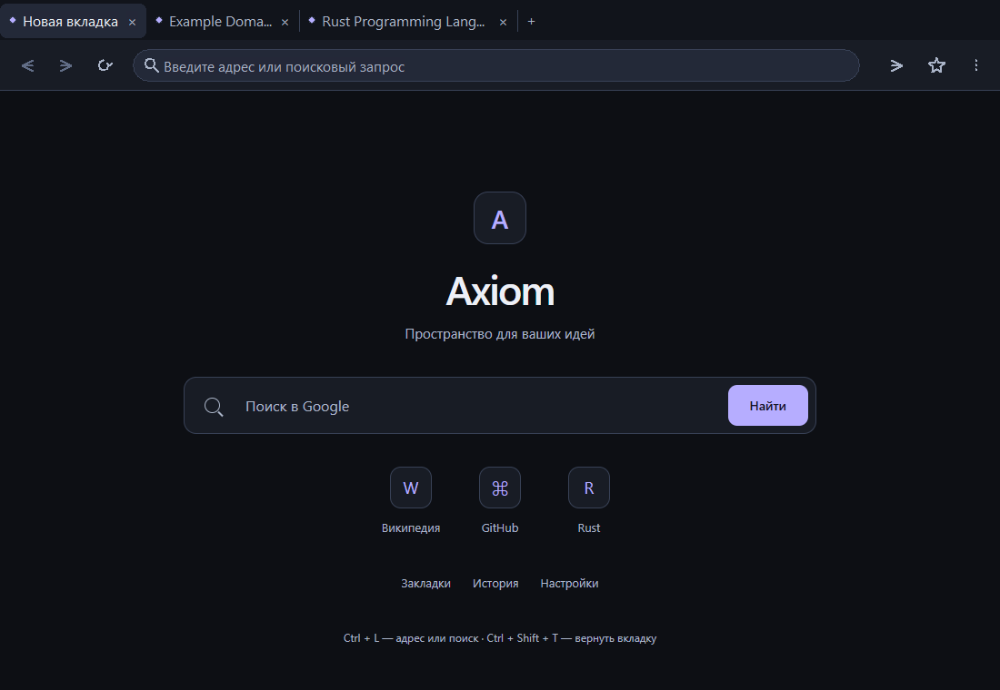
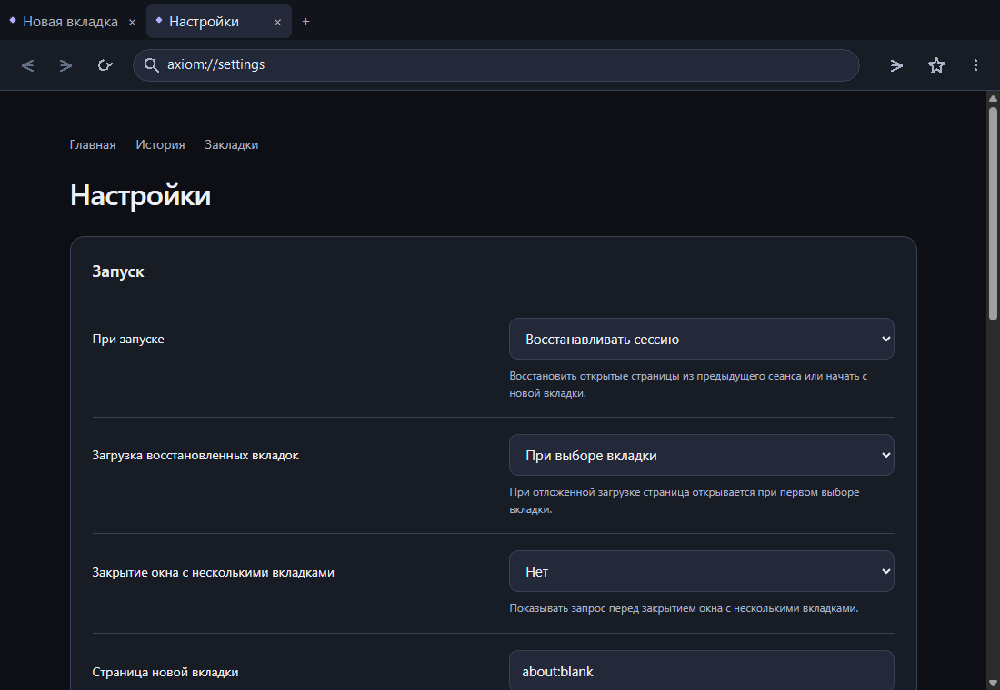
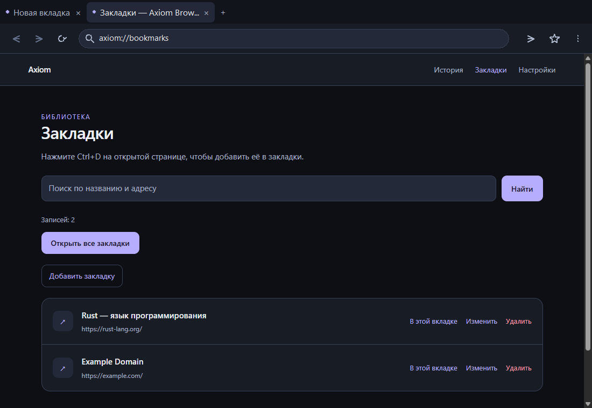

# Axiom Browser 0.1.5

Небольшой браузер для Windows 10/11 x64 на Rust, Wry и Microsoft Edge WebView2. В версии 0.1.5 интерфейс и внутренние страницы оформлены по палитре Void: глубокий графит, сдержанный фиолетовый оттенок и чёткие контуры без фоновых эффектов. Сайты сохраняют собственное оформление.

## Запуск и навигация

Дважды нажмите `launch.cmd`. Готовая программа находится в `dist/AxiomBrowser.exe`; если её нет, запускатель вызывает `cargo run --release`. Для готового EXE нужен Microsoft Edge WebView2 Runtime.

Введите адрес или запрос и нажмите Enter. Можно выбрать Google, Bing или DuckDuckGo; домены открываются по HTTPS, localhost и loopback — по HTTP. Кнопки и сочетания `Alt+←` / `Alt+→` переходят назад и вперёд; `Ctrl+R` и `F5` обновляют страницу.

Адресная панель и вкладки используют нативные элементы Windows с тёмным оформлением, собственными GDI-иконками и подсказками. Вкладки можно создавать, закрывать крестиком или средней кнопкой мыши, перемещать через контекстное меню и прокручивать при переполнении. Контекстное меню вкладки поддерживает дублирование, перемещение влево/вправо, закрытие остальных или вкладок справа. `Ctrl+Shift+T` восстанавливает недавно закрытую вкладку; список ограничен 20 записями и хранится до закрытия браузера. Дублируется адрес текущей вкладки, состояние JavaScript не копируется.



## Настройки, история и закладки

Настройки позволяют выбрать стартовую страницу, домашний адрес, поисковую систему, восстановление прошлой сессии и ленивую либо полную загрузку восстановленных вкладок. Масштаб страниц регулируется от 50% до 200% и применяется сразу к уже открытым и новым страницам. Дополнительно можно включить подтверждение закрытия нескольких вкладок и отключить запись истории; историю можно очистить из её страницы. Сохранённые параметры переживают перезапуск.



Менеджер закладок поддерживает поиск, добавление, редактирование, подтверждение удаления и открытие в текущей или новой вкладке. Повторное добавление того же URL обновляет существующую запись. Команда «Открыть все» создаёт вкладки для сохранённых адресов.



Меню «⋮» открывает историю (`Ctrl+H`), закладки (`Ctrl+Shift+O`) и настройки. Звезда рядом с адресом сохраняет страницу (`Ctrl+D`). Восстановление сессии возвращает URL и заголовки, но не значения форм, JavaScript-состояние и историю переходов внутри вкладки. Одновременно разрешён один обычный экземпляр браузера; повторный запуск сообщает об уже открытом окне.

Горячие клавиши: `Ctrl+T` — новая вкладка, `Ctrl+W` — закрыть, `Ctrl+L` — адресная строка, `Ctrl+Tab` / `Ctrl+Shift+Tab` — следующая / предыдущая вкладка, `Ctrl+Shift+T` — восстановить закрытую вкладку.

Профиль с cookie находится в `%LOCALAPPDATA%\AxiomBrowser\Profile`; сессия, настройки, история и закладки хранятся в `browser.sqlite3` в этой папке. Обязательных серверов Axiom и телеметрии нет.

## Сборка и проверки

Для сборки нужны Rust stable `x86_64-pc-windows-msvc`, Visual Studio C++ Build Tools, Windows SDK и WebView2 Runtime.

```powershell
powershell -ExecutionPolicy Bypass -File scripts/check-environment.ps1
cargo test --locked
cargo build --release --locked
New-Item -ItemType Directory -Force dist
Copy-Item target/release/axiom-browser.exe dist/AxiomBrowser.exe
```

В 0.1.5 прошли 35 модульных тестов. Восстановление сессии в ленивом и полном режимах подтвердило четыре видимые вкладки (`CORE_VERIFIED`); 12-шаговая smoke-проверка завершилась `TABS_VERIFIED` с пятью вкладками. Также проверены добавление закладки и дедупликация URL, редактирование, открытие всех записей, подтверждение удаления, сохранение настроек масштаба 125%, очистка и отключение истории, дублирование, перемещение, закрытие и восстановление вкладки. Детали и команды — в [`docs/verification-0.1.5.md`](docs/verification-0.1.5.md).

Для запуска отдельного smoke-сценария:

```powershell
cargo run --locked -- --smoke-test
```

Он использует изолированный профиль `.smoke-profile`. Smoke-проверка 0.1.5 прошла все 12 шагов; результаты приведены в протоколе проверки.

## Проектные заметки

Палитра и правила интерфейса описаны в [`docs/design-void.md`](docs/design-void.md). После пользовательской проверки версии планируется пауза перед следующим этапом работ.
