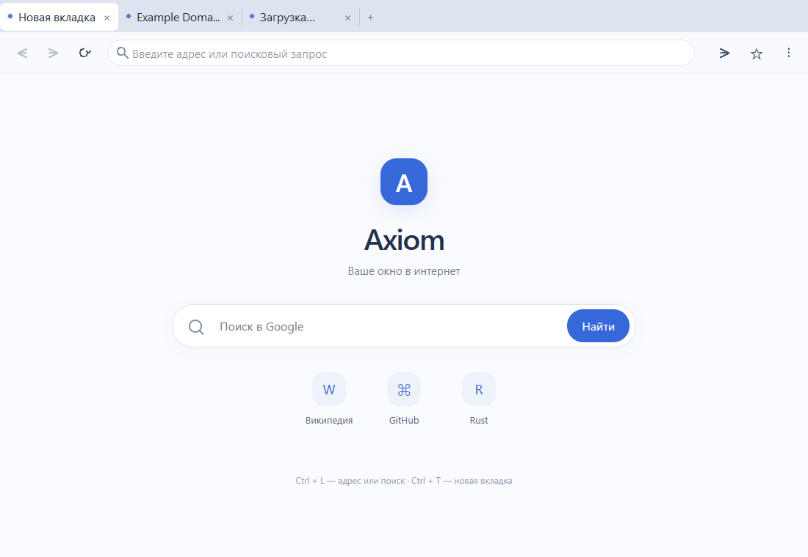

# Axiom Browser 0.1.4

Небольшой браузер для Windows 10/11 x64 на Rust, Wry и Microsoft Edge WebView2. Версия 0.1.4 развивает внутренние страницы и восстановление вкладок; крупного обновления внешнего вида в этой версии нет.

## Запуск

Дважды нажмите `launch.cmd`. Готовая программа находится в `dist/AxiomBrowser.exe`. Если EXE отсутствует, запускатель вызывает `cargo run --release`. Для готового EXE нужен только Microsoft Edge WebView2 Runtime; Rust, Cargo и Visual Studio пользователю не нужны.

Введите адрес или поисковый запрос и нажмите Enter. Домены открываются как сайты, слова и фразы отправляются выбранной поисковой системе: Google, Bing или DuckDuckGo. Для публичных сайтов без схемы используется HTTPS, для localhost и loopback — HTTP. Стрелки управляют переходами назад и вперёд, круговая стрелка обновляет страницу. Недоступные переходы отображаются неактивными.

Полоса вкладок показывает заголовки страниц, позволяет создавать и закрывать вкладки, а также прокручивается при переполнении. Нажмите «+» для новой вкладки, заголовок — для выбора, «×» или среднюю кнопку мыши — для закрытия. При закрытии последней вкладки браузер завершает работу. Вкладки сохраняют отдельные страницы и историю переходов; cookie и профиль общие. Исправлена прокрутка полосы при расширении окна: ранее скрытые восстановленные вкладки снова становятся видны.

При первом запуске открывается встроенная стартовая страница Axiom. Настройки позволяют выбрать поведение запуска — восстановить сессию или открыть новую вкладку — и домашнюю страницу. Восстановленные вкладки загружаются по мере выбора или все сразу. Поисковую систему можно переключить между Google, Bing и DuckDuckGo. При необходимости можно включить подтверждение закрытия нескольких вкладок. Параметры восстановления применяются при следующем запуске; поисковая система, домашняя страница новых вкладок и подтверждение закрытия применяются сразу после сохранения.

Сессия сохраняется после изменений и закрытия окна. Восстанавливаются URL и заголовки, но не значения форм, JavaScript-состояние или история переходов внутри каждой вкладки. Закрытые вручную вкладки удаляются из сессии; если закрыть последнюю вкладку, следующий запуск начнётся с домашней страницы. Одновременно разрешён только один обычный экземпляр браузера; второй запуск покажет сообщение и предложит использовать открытое окно.

Звёздочка справа от адресной строки добавляет текущую страницу в закладки (`Ctrl+D`). Меню «⋮» открывает историю (`Ctrl+H`), закладки (`Ctrl+Shift+O`) и настройки. Менеджер закладок поддерживает поиск по адресу и названию, изменение и удаление записей. Страницу можно открыть в текущей вкладке или новой; команда «Открыть все закладки» создаёт вкладку для каждой сохранённой страницы. История показывает последние 200 записей. Внутренние страницы браузера в историю не попадают.



Горячие клавиши: `Ctrl+T` — новая вкладка, `Ctrl+W` — закрыть, `Ctrl+L` — адресная строка, `Ctrl+Tab` / `Ctrl+Shift+Tab` — следующая / предыдущая вкладка. Escape в адресной строке отменяет неотправленный ввод.

Профиль с cookie хранится в `%LOCALAPPDATA%\AxiomBrowser\Profile`. Сессия, настройки, история и закладки находятся в `browser.sqlite3` в этой папке. SQLite использует транзакции и WAL; ошибочная запись не заменяет предыдущую сессию. Обязательных серверов Axiom и телеметрии нет.

## Сборка и модульные проверки

Нужны Rust stable `x86_64-pc-windows-msvc`, Visual Studio C++ Build Tools, Windows SDK и WebView2 Runtime.

```powershell
powershell -ExecutionPolicy Bypass -File scripts/check-environment.ps1
cargo test --locked
cargo build --release --locked
New-Item -ItemType Directory -Force dist
Copy-Item target/release/axiom-browser.exe dist/AxiomBrowser.exe
```

В версии 0.1.4 прошли 33 модульных теста, восстановление с ленивой и полной загрузкой вкладок, операции настроек и закладок через POST, повторное открытие базы данных и 12-шаговая smoke-проверка. Подробности и команды находятся в [`docs/verification-0.1.4.md`](docs/verification-0.1.4.md). Проверка среды не устанавливает компоненты и ничего не меняет.

## Smoke-проверка

```powershell
cargo run --locked -- --smoke-test
```

Smoke-проверка использует отдельный профиль `.smoke-profile`, загружает сетевые HTTPS-сайты и проверяет навигацию, пять вкладок, общую COM-среду WebView2, cookie, сохранение JavaScript-состояния и защиту адресной строки от фоновых событий. Код выхода 0 означает успешный сценарий; код 1 — ошибку или таймаут в 60 секунд.

## Проверка восстановления

Посев создаёт тестовую сессию из четырёх вкладок с длинными заголовками. Посев и проверку запускайте отдельными командами:

```powershell
cargo run --locked -- --seed-session-test
cargo run --locked -- --restore-test
```

Вариант с немедленной загрузкой всех восстановленных страниц:

```powershell
cargo run --locked -- --seed-session-test --restore-all
cargo run --locked -- --restore-test
```

Оба сценария используют `.restore-profile` и не затрагивают основной профиль. Команда `--restore-all` применяется при посеве, а затем тестовый запуск проверяет восстановленную сессию. Подробный журнал проверки 0.1.4 находится в [`docs/verification-0.1.4.md`](docs/verification-0.1.4.md).

## Дальнейшая работа

Следующая цель после пользовательской проверки этой версии — упорядочить внутреннюю структуру приложения и его внутренних страниц до отдельного этапа визуального развития. После каждого этапа оставляется пауза для пользовательского тестирования. Подробный технический план — [`docs/Axiom_Browser_Technical_Plan_v0.1.md`](docs/Axiom_Browser_Technical_Plan_v0.1.md).
