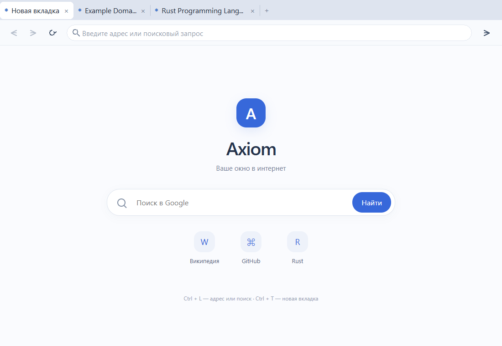

# Axiom Browser 0.1.2

Минимальный браузер для Windows 10/11 x64 на Rust и Microsoft Edge WebView2.

## Запуск

Дважды нажмите `launch.cmd`. Готовая программа находится в `dist/AxiomBrowser.exe`. Если EXE отсутствует, запускатель вызывает `cargo run --release`. Для готового EXE нужен только Microsoft Edge WebView2 Runtime, Rust и Visual Studio пользователю не нужны.

Введите адрес или поисковый запрос и нажмите Enter. Домены открываются как сайты, слова и фразы отправляются в Google. Для публичных сайтов без схемы используется HTTPS, для localhost и loopback — HTTP. Стрелки слева управляют переходами назад/вперёд, круговая стрелка обновляет страницу. Недоступные переходы отображаются неактивными.

Вверху расположена полоса вкладок. Нажмите «+» для новой вкладки, её заголовок — для выбора, «×» или среднюю кнопку мыши — для закрытия. При переполнении доступны прокрутка колёсиком и стрелки. При закрытии последней вкладки браузер завершает работу. Вкладки сохраняют свои страницы и отдельную историю переходов; cookie и профиль общие.

При запуске открывается локальная страница Axiom с поиском Google и быстрыми ссылками. Для отображения стартовой страницы интернет не требуется. Поисковые запросы передаются Google только после отправки; подсказок с передачей текста по мере набора нет.



Горячие клавиши: `Ctrl+T` — новая вкладка, `Ctrl+W` — закрыть, `Ctrl+L` — адресная строка, `Ctrl+Tab` / `Ctrl+Shift+Tab` — следующая / предыдущая вкладка. Escape в адресной строке отменяет неотправленный ввод.

Профиль с cookie хранится в `%LOCALAPPDATA%\AxiomBrowser\Profile`. Обязательных серверов Axiom и телеметрии нет. Страницы напрямую соединяются со своими серверами.

## Сборка

Нужны Rust stable x86_64-pc-windows-msvc, Visual Studio C++ Build Tools, Windows SDK и WebView2 Runtime.

```powershell
powershell -ExecutionPolicy Bypass -File scripts/check-environment.ps1
cargo test --locked
cargo build --release --locked
New-Item -ItemType Directory -Force dist
Copy-Item target/release/axiom-browser.exe dist/AxiomBrowser.exe
```

## Проверка сайтов

```powershell
cargo run --locked -- --smoke-test
```

Проверка загружает HTTPS-сайты, проверяет навигацию, пять одновременно открытых вкладок, локальную новую вкладку и отправку поискового запроса в Google. Проверяются общая COM-среда WebView2, общий cookie, сохранность JavaScript-состояния при переключении, защита вводимого адреса от фоновых событий и закрытие вкладок. Код выхода 0 означает успешный сценарий, 1 — ошибку или таймаут 60 секунд. Используется отдельный профиль `.smoke-profile`.

`--ui-preview` создаёт снимок собственного окна в `screenshots/axiom-0.1.2.bmp` и завершает приложение. Профиль для этой проверки отдельный: `.preview-profile`.

## Объём версии

Одно окно с несколькими вкладками, светлым нативным интерфейсом, единой адресной и поисковой строкой, HTTPS/HTTP, навигацией и постоянным профилем. Скрытые вкладки продолжают работать, автоматического сна и выгрузки ещё нет. Запрашиваемые разрешения и дополнительные окна запрещены. Интерфейс разрешений, сохранение сессии, журнал истории, закладки и экономия памяти будут отдельными этапами. Не проверена совместимость каждого сайта, DRM и сложных авторизаций.

Полный технический план находится в `docs/Axiom_Browser_Technical_Plan_v0.1.md`; эта версия реализует базовый браузер с вкладками. Следующий этап — локальная история, закладки и восстановление сессии.
