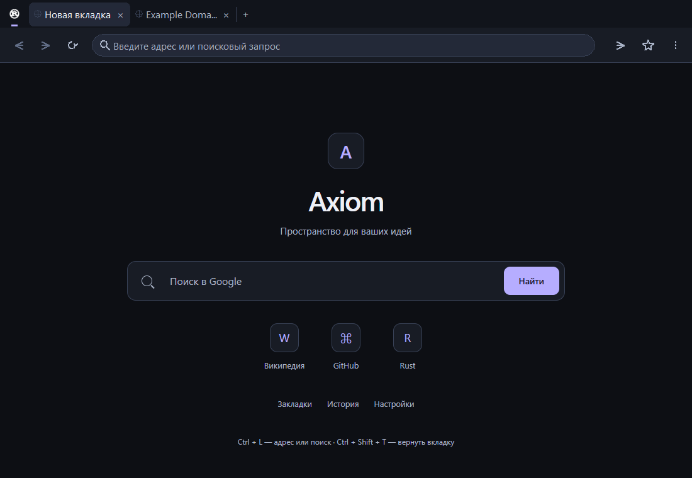
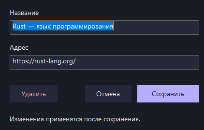

# Проверка Axiom Browser 0.1.6

## Подтверждено

- 37 модульных тестов и release-сборка прошли.
- В работающем WebView2 прошёл core-сценарий в ленивом и полном режимах: сохранение/редактирование закладки в нативном редакторе без новой вкладки, отмена новой закладки без записи, перетаскивание через сообщения мыши собственному HWND, группировка закреплённых вкладок и запрет перехода через границу групп, сохранение pinned при восстановлении закрытой вкладки.
- Получен и декодирован настоящий PNG-favicon Rust через WebView2. Проверены события начала/завершения загрузки и отклонение запоздалого favicon предыдущей навигации.
- Отдельный запуск `--restore-pinned-test` восстановил шесть видимых вкладок, две закреплённые в начале и выбранную страницу. «Закрыть другие» сохранило обе закреплённые вкладки.
- Сохранились проверки менеджера закладок, масштаба, истории и восстановления сессии из 0.1.5.
- HTTPS smoke-тест прошёл 12 шагов и завершился `TABS_VERIFIED`: пять вкладок, общая среда/cookie, сохранённое состояние страниц и адресного ввода, поиск, закрытие и защита от событий уже закрытых вкладок.
- Снимки интерфейса и редактора сделаны через PrintWindow только собственных окон приложения и просмотрены.

Один ранний startup-check завершился без подробной диагностики; расхождение не воспроизвелось в последующих запусках. В диагностике теперь выводятся число WebView, выбранная вкладка и видимые вкладки. Асинхронные результаты core-теста помечены номером этапа, чтобы устаревшие ответы не влияли на следующий этап.

## Повторение

```powershell
cargo test --locked
cargo build --release --locked
cargo run --locked -- --seed-session-test
cargo run --locked -- --restore-test
cargo run --locked -- --restore-pinned-test
cargo run --locked -- --seed-session-test --restore-all
cargo run --locked -- --restore-test
cargo run --locked -- --smoke-test
```

Core использует `.restore-profile`, smoke — `.smoke-profile`, снимки — `.preview-profile`. Основной профиль пользователя эти сценарии не меняют.

## Пользовательская проверка

Проверить длительное перетаскивание при переполнении с прокруткой у краёв, отмену перетаскивания за пределами окна, клавиатурный обход редактора и его диалог подтверждения удаления. Эти взаимодействия реализованы, но полный ручной сценарий в этой проверке не выполнялся. Закреплённая вкладка не имеет крестика; её можно закрыть средней кнопкой, Ctrl+W или контекстным меню. Полноценный ручной прогон этих трёх способов для закреплённой вкладки остаётся пользователю.




